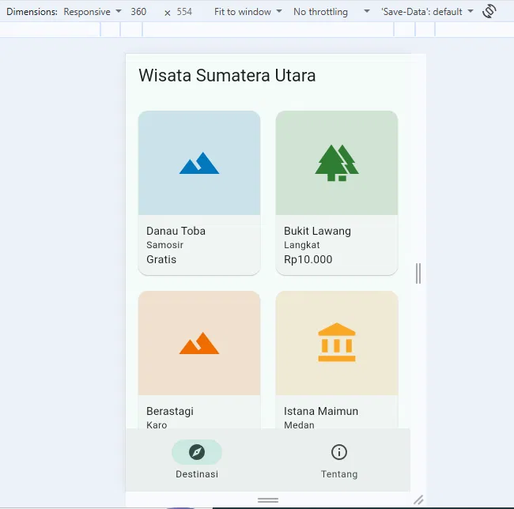
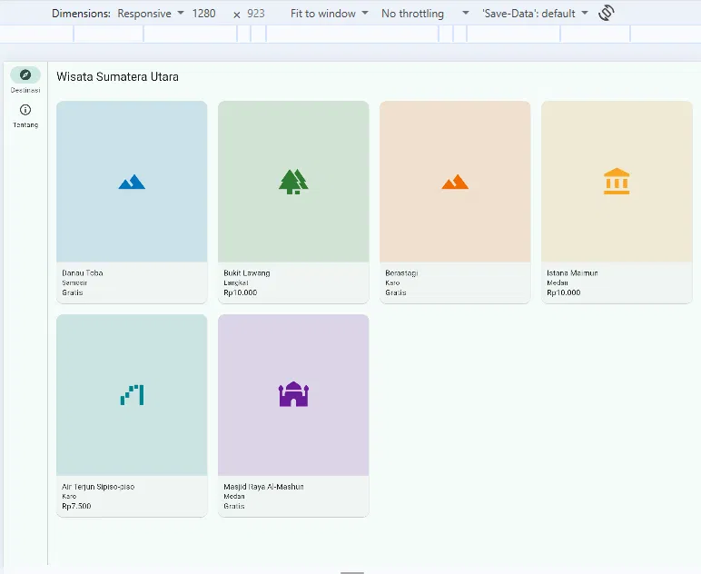
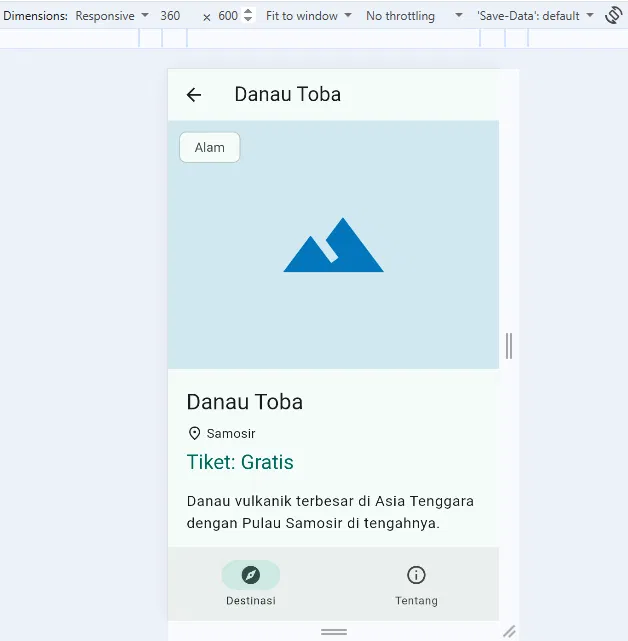
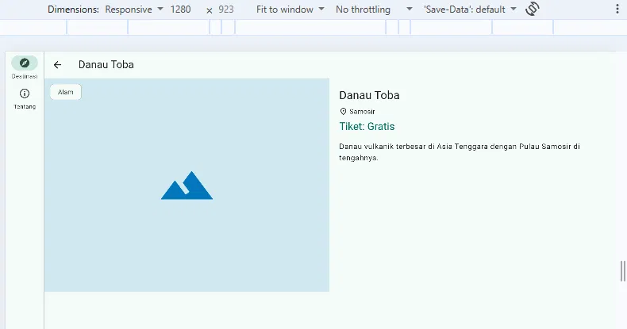

# Wisata Sumatera Utara

- Nama: Dea Anggraini
- NIM: 4243250051
- Mata kuliah: Pemrograman Mobile (3KOM40215), Tugas Rutin 6

## Tangkapan Layar

| Ponsel (360 dp) | Tablet (1280 dp) |
|---|---|
|  |  |
|  |  |

## Keputusan Responsif

MediaQuery.sizeOf dipakai di KerangkaNavigasi karena pilihan NavigationBar atau NavigationRail menyangkut seluruh layar; batasnya 840 dp sesuai window size class Material 3. LayoutBuilder dipakai di grid dan halaman detail karena keputusan di sana bergantung pada ruang yang tersisa untuk widget itu, bukan ukuran layar. Grid memakai 2 kolom di bawah 600 dp, 3 kolom di bawah 900 dp, dan 4 kolom di atasnya. Karena NavigationRail memakan sekitar 80 dp di layar lebar, ruang grid lebih kecil daripada lebar layar, sehingga LayoutBuilder memberi hasil yang lebih tepat dibandingkan MediaQuery. Halaman detail berdampingan pada lebar 700 dp ke atas dan vertikal di bawahnya. Teks nama dan lokasi diberi ellipsis atau dibungkus Expanded agar tidak overflow pada 360–1280 dp. Rute detail memakai path parameter :id, dan ID yang tidak dikenal atau bukan angka menampilkan halaman tidak ditemukan.

## Penggunaan AI

Saya menggunakan Claude (Anthropic) sebagai bantuan belajar untuk menyusun kode dan struktur proyek. Saya sudah menjalankan, menguji, dan memahami seluruh kode yang dikumpulkan.